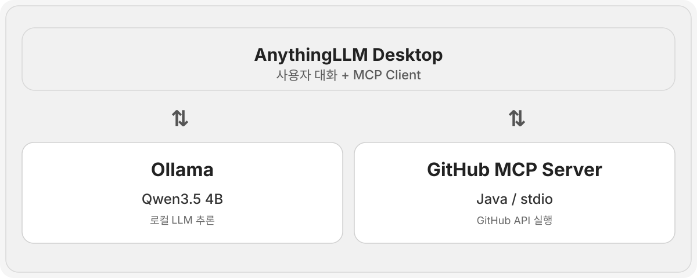

# GitHub MCP Server

**Java 21, Spring Boot, Spring AI**를 기반으로 구현한 GitHub MCP 서버입니다.

GitHub REST API의 주요 기능을 MCP(Model Context Protocol) Tool로 제공하여, MCP를 지원하는 AI 클라이언트가 GitHub 저장소의 정보를 조회하거나 작업을 수행할 수 있도록 합니다.

이를 통해 LLM이 사용자의 자연어 요청을 이해하고, 적절한 MCP Tool을 호출하여 GitHub 작업을 처리하는 환경을 구축하는 것이 목표입니다.

<br/>

## Architecture



본 프로젝트는 다음 구성요소를 활용합니다.

- **MCP Client**: AnythingLLM Desktop과 같은 MCP 지원 클라이언트
- **Local LLM**: Ollama를 통해 로컬에서 실행하는 Qwen3.5 4B 모델
- **GitHub MCP Server**: Spring AI 기반으로 구현한 stdio 방식의 MCP 서버
- **GitHub REST API**: Personal Access Token(PAT) 인증을 통해 GitHub 리소스에 접근

사용자가 자연어로 요청하면 LLM이 적절한 도구를 선택하고, MCP Client가 해당 도구를 실행합니다. GitHub MCP Server는 GitHub REST API를 호출한 뒤 결과를 반환하며, LLM은 이를 바탕으로 사용자에게 응답합니다.

<br/>

## What This Server Can Do

현재 구현된 MCP Tool은 다음과 같습니다.

| MCP Tool | 설명 |
|---|---|
| `get_repository` | GitHub 저장소의 이름, 설명, 기본 브랜치 등의 정보를 조회합니다. |
| `get_authenticated_user` | PAT로 인증된 GitHub 사용자 정보를 조회합니다. |
| `create_issue` | 지정한 저장소에 새로운 Issue를 생성합니다. |
| `create_branch` | 기존 브랜치를 기준으로 새로운 브랜치를 생성합니다. |
| `get_file_content` | 지정한 브랜치의 파일을 조회하고 내용을 디코딩하여 반환합니다. |
| `list_directory` | 지정한 브랜치의 디렉터리에 포함된 파일과 하위 디렉터리 목록을 조회합니다. |

<br/>

## Features

### Repository Operations

- GitHub 저장소의 메타데이터 조회
- 인증된 GitHub 사용자 정보 조회

### Issue Management

- GitHub Issue 생성
- Issue 제목 및 본문 설정

### Branch Management

- Git Reference 조회를 통한 기준 브랜치의 커밋 SHA 확인
- 기존 브랜치의 SHA를 활용한 새로운 브랜치 생성
- `main`, `master`, `develop` 등 사용자 지정 브랜치 지원

### File Retrieval

- GitHub Contents API를 활용한 파일 조회
- 특정 브랜치의 파일 조회
- 하위 디렉터리에 위치한 파일 경로 지원
- Base64로 인코딩된 파일 내용을 UTF-8 텍스트로 변환
- 파일 이름, 경로, SHA 등의 메타데이터 반환

### Directory Listing

- GitHub Contents API를 활용한 디렉터리 목록 조회
- 특정 브랜치의 디렉터리 조회
- 저장소 루트 및 중첩된 하위 디렉터리 경로 지원
- `pathSegment()`를 활용한 디렉터리 경로 구성
- 파일 및 디렉터리 이름, 경로, 타입, SHA, 크기 등의 메타데이터 반환
- `ParameterizedTypeReference`를 활용한 DTO 목록 역직렬화
- 현재 디렉터리의 직속 항목만 조회하는 비재귀 방식 지원

### Error Handling

- `RestClient.defaultStatusHandler()`를 활용한 GitHub API 공통 오류 처리
- HTTP 상태 코드에 따른 애플리케이션 에러 코드 매핑
- `ErrorCode`와 `GithubException`을 활용한 커스텀 예외 처리
- 파일 타입, 인코딩 방식 및 응답 데이터 검증
- 존재하지 않는 디렉터리 경로에 대한 GitHub API 오류 처리

<br/>

## Tech Stack

| 구분 | 기술 |
|---|---|
| Language | Java 21 |
| Framework | Spring Boot 4.1.2 |
| AI Framework | Spring AI 2.0.2 |
| Build Tool | Gradle |
| Protocol | Model Context Protocol (MCP) |
| Transport | stdio |
| External API | GitHub REST API |
| Authentication | GitHub Personal Access Token (PAT) |
| Local LLM | Ollama + Qwen3.5 4B |
| MCP Client | AnythingLLM Desktop, MCP Inspector |

<br/>

## Project Structure

```text
src/main/java/com/github_mcp_server
├── dto
│   ├── branch         # 브랜치 생성 및 Git Reference DTO
│   ├── file           # 파일 내용 및 디렉터리 목록 조회 DTO
│   ├── issue          # Issue 생성 및 응답 DTO
│   └── repository     # 저장소 정보 DTO
├── exception          # 공통 에러 코드 및 커스텀 예외
├── service            # GitHub REST API 호출 및 비즈니스 로직
└── tool               # MCP Tool 정의 및 등록
```

각 계층의 역할은 다음과 같습니다.

- **DTO**: GitHub REST API 요청 및 응답 데이터를 정의합니다.
- **Exception**: 공통 에러 코드를 관리하고 커스텀 예외를 제공합니다.
- **Service**: `RestClient`를 사용하여 GitHub API를 호출하고 응답 데이터를 처리합니다.
- **Tool**: `@McpTool`을 사용하여 Service의 기능을 MCP Tool로 노출합니다.

<br/>

## Current Limitations

현재 구현에서는 다음과 같은 제약이 있습니다.

- 파일 조회는 UTF-8 텍스트 파일을 대상으로 합니다.
- 디렉터리 목록 조회는 현재 디렉터리의 직속 파일 및 하위 디렉터리만 반환하며, 재귀 탐색은 지원하지 않습니다.
- 바이너리 파일과 대용량 파일 처리는 지원하지 않습니다.
- 디렉터리 목록 조회 시 파일 경로를 전달하는 경우에 대한 별도 타입 검증은 구현하지 않았습니다.
- 네트워크 연결 실패 및 타임아웃에 대한 별도의 커스텀 예외 처리는 구현하지 않았습니다.
- 로컬 LLM의 Tool Calling 정확도에 따라 도구 선택이나 응답 결과가 달라질 수 있습니다.

<br/>

## Roadmap

- [x] GitHub 저장소 및 사용자 정보 조회
- [x] GitHub Issue 생성
- [x] GitHub 브랜치 생성
- [x] GitHub 파일 내용 조회
- [x] GitHub 디렉터리 목록 조회
- [x] 공통 API 예외 처리
- [x] Ollama 기반 로컬 LLM 연동 및 MCP Tool 호출 검증
- [ ] GitHub 저장소 전체 파일 트리 재귀 조회
- [ ] GitHub 파일 생성 및 수정
- [ ] GitHub Pull Request 생성 및 관리
- [ ] API 및 MCP Tool 자동화 테스트
- [ ] 자연어 기반 GitHub 작업 자동화의 정확도 및 안정성 개선
